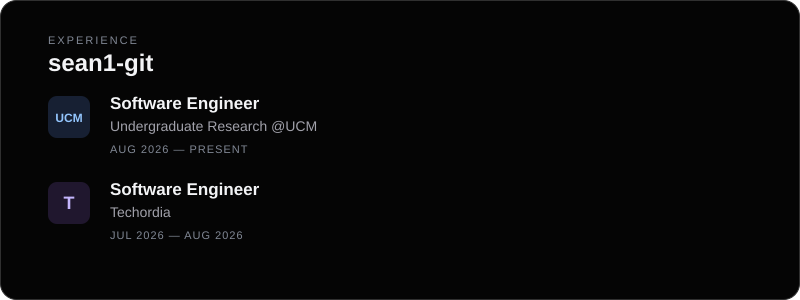

## Hi there 👋

Full-Stack Software Engineer focused on building scalable, end-to-end web applications with frontend and backend development, APIs, cloud deployment, testing, and secure systems.

## Projects I'm currently working on:

UC Merced Campus Store | Full-Stack PWA & Autonomous Delivery Platform 

UC Merced Parking | Cross-Platform App & Computer Vision System 

  

